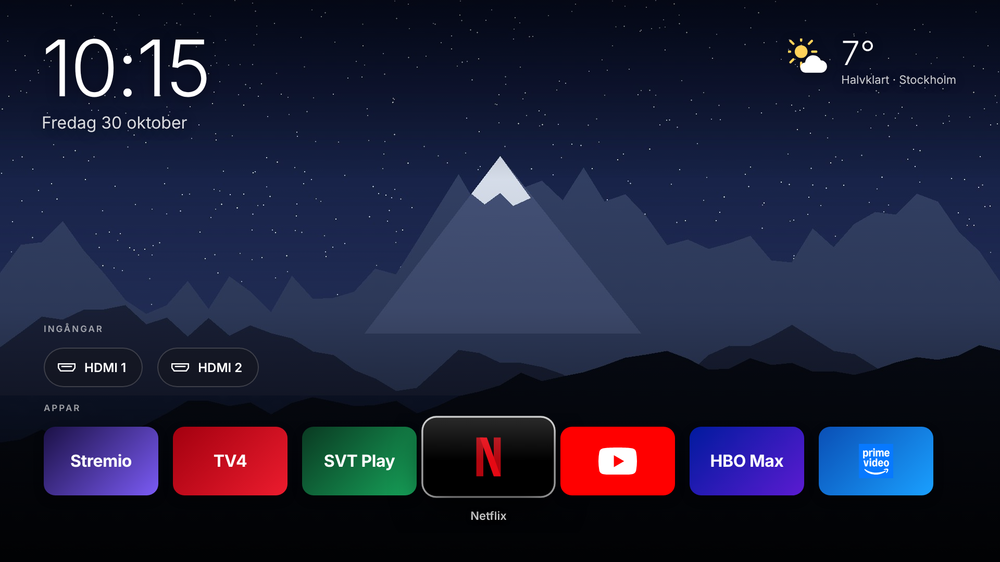

# Hemskärm för LG webOS

En egen hemskärm i Luma/Apple TV-stil för rootade LG-TV:ar, byggd för **webOS 4.5**
(testad mot LG 43UM7100PLB). Bakgrundsbild, stor klocka, väder, HDMI-ingångar och appar.
Öppnas när du trycker **HOME** och när TV:n slås på.



## Installera via Homebrew Channel

Lägg till den här adressen som extra repository i Homebrew Channels inställningar:

```
https://github.com/Neoorell/lg-hemskarm/releases/latest/download/repo.json
```

Installera **Hemskärm** från listan och kör sedan en gång, som root över SSH:

```sh
sh /media/developer/apps/usr/palm/applications/se.minhemskarm.launcher/setup/setup.sh
```

Uppdateringar dyker sedan upp i Homebrew Channel. Bakgrundstjänsten startar om sig själv
med den nya versionen, så `setup.sh` behöver inte köras igen.

Hela guiden på svenska: [GUIDE.md](GUIDE.md)

## Bygga

```sh
python3 build/build_ipk.py
```

Allt i `dist/` laddas upp till en GitHub-release med taggen `v<version>` (versionen står i `app/appinfo.json`).

## Krav

- Rootad TV med [Homebrew Channel](https://www.webosbrew.org/) och SSH
- TV:ns egen `node` (finns på webOS 4) och `curl` för vädret

Bygger på [lg-webos-custom-home](https://github.com/NaveenDA/lg-webos-custom-home) av NaveenDA (MIT).
